<!-- SPDX-License-Identifier: MIT -->

# DM32Mayhem

A **HackRF-portapak-inspired firmware for the Baofeng DM-32UV**, built on the RadioFoundry tree. The radio boots into a
two-by-three app grid, and each app is a small transmitter with its own panel. Transmission is app-driven: there is no
manual PTT in this build.

**Web flasher:** [dm32mayhem.com](https://dm32mayhem.com/) — back up, install and restore the firmware over the
programming cable in Chrome or Edge.

<p align="center">
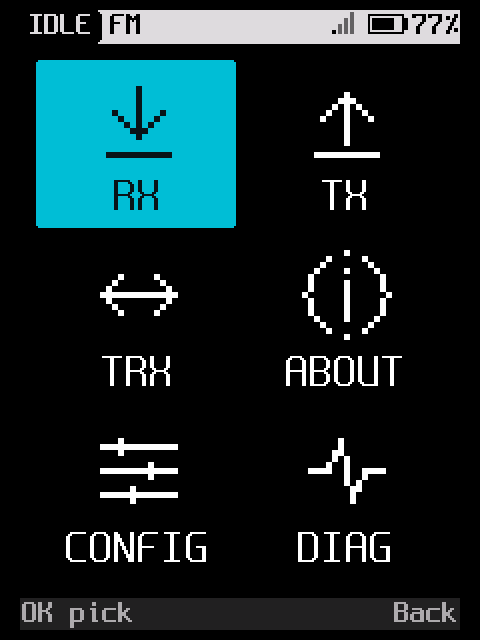
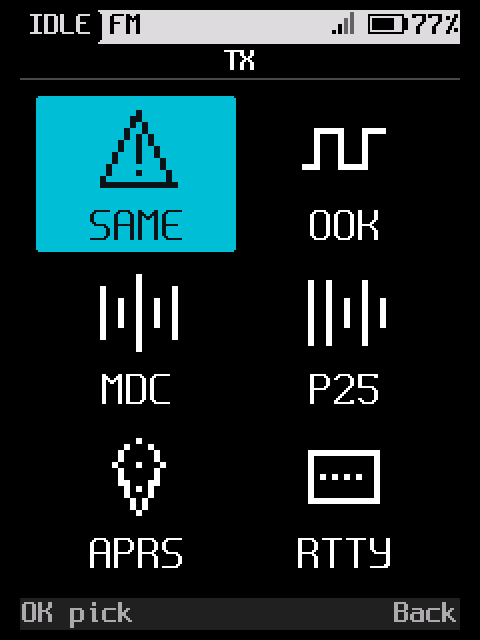
</p>

*Home (RX, TX, TRX, About, Config, Diagnostics) and the TX app grid. RX and TRX are the same grid, ready for the
receive and transceive apps.*

## Boot gate

Every power-on opens with the responsibility notice and a six-digit code generated for that boot. No app, key or
transmitter is available until the code is typed; Back deletes a digit, and a wrong code clears the entry and asks
again. It is an acknowledgement, not a security lock: the code is on the panel.

<p align="center">
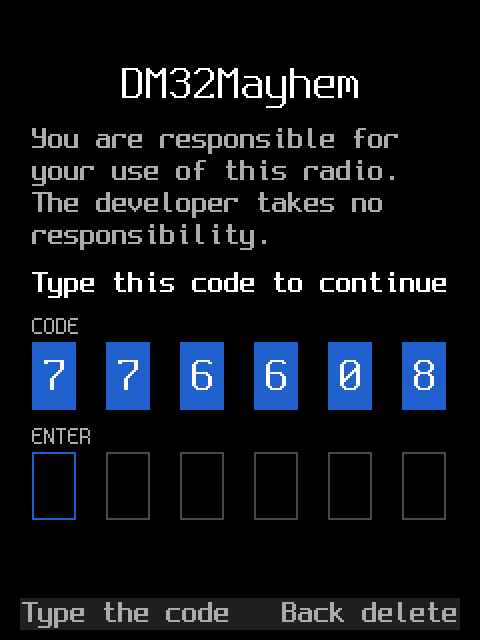
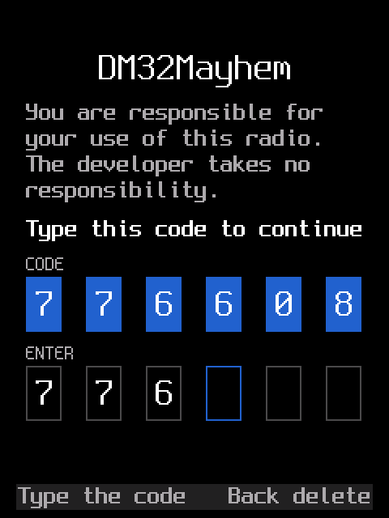
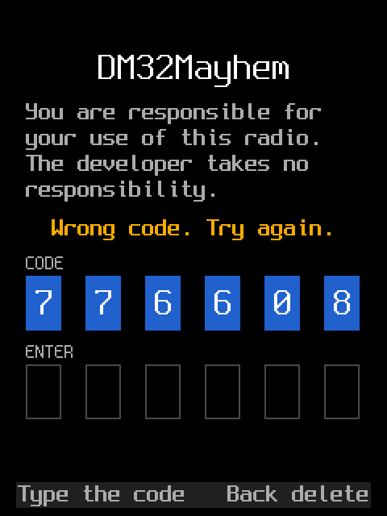
</p>

## Applications

| App | What it sends |
|---|---|
| **SAME TX** | NOAA/EAS SAME headers over FM AFSK |
| **OOK TX** | On-off keyed PA: a hex code or a de Bruijn sequence |
| **MDC-1200 TX** | Motorola MDC-1200 ANI/PTT ID and the other opcodes |
| **P25 CC TX** | A P25 Phase 1 control channel |
| **APRS TX** | APRS status, message and position packets |
| **RTTY TX** | ITA2/Baudot RTTY |

### SAME TX

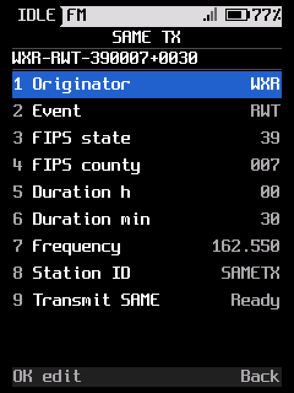

The standard SAME header (`ZCZC-ORG-EEE-PSSCCC+TTTT-JJJHHMM-LLLLLLLL-`, three repeats, 520.83 baud AFSK) built from an
originator, event, FIPS state and county, valid time, station ID and frequency. The issue time comes from the radio's
GPS when it has one, otherwise the standard placeholder.

### OOK TX

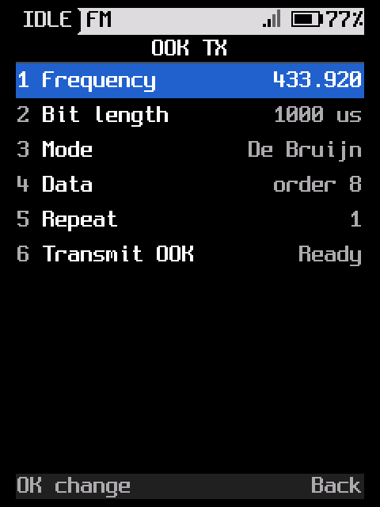

On-off keying by switching the PA drive at the bit rate. A hex code or the binary de Bruijn sequence, encoded as the
common PWM remotes expect (`0 = 1000`, `1 = 1110`), with frequency, bit length, repeats and de Bruijn order. One
millisecond is the default bit length: shorter pulses do not let the PA bias settle.

### MDC-1200 TX

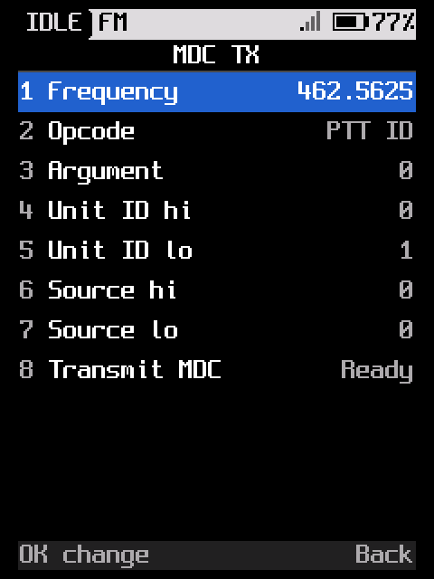

PTT ID/ANI, emergency, radio check, stun and unstun, call alert, sel call 1/2, status request/response, remote monitor
and message. The PDU carries the CRC, convolutional code and interleave, NRZI-encoded, as 1200 baud AFSK (mark
1800 Hz, space 1200 Hz).

### P25 CC TX

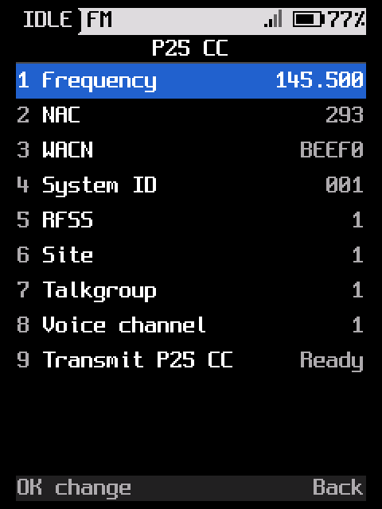

A P25 Phase 1 control channel: frame sync, BCH NID, and rotating IDEN_UP, NET_STS, RFSS_STS and group voice grant
TSBKs. The site is set by NAC, WACN, system ID, RFSS, site, talkgroup and voice channel; the bytes go through the
modem's physical-layer 4FSK transmitter.

### APRS TX

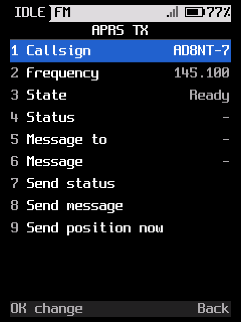

Compose and send an APRS status, a text message to a callsign, or the current position. The APRS engine frames the
AX.25, keys, retries and tunes; the app shows the radio's APRS callsign, frequency and why a send is blocked.

### RTTY TX

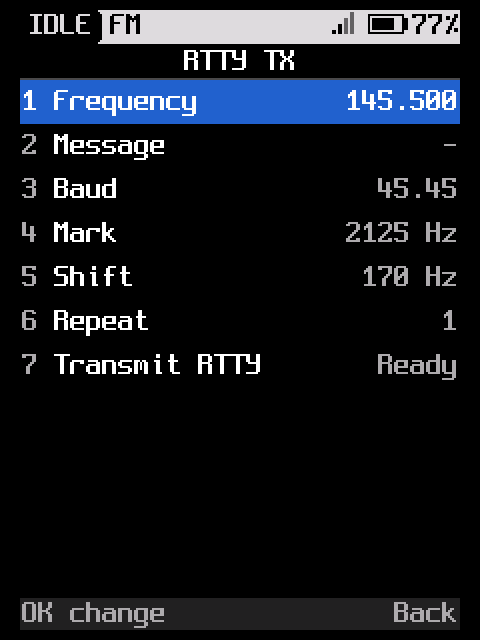

ITA2/Baudot RTTY at 45.45 or 50 baud, with selectable mark and shift (space = mark + shift), a repeated message and a
long text field, sent through the AFSK path.

## How the transmissions work

- **AFSK** (SAME, MDC-1200, RTTY) through the HR_C7000 FM modulator at 8 kHz PCM.
- **OOK** by switching the PA drive (DAC B) at the bit rate.
- **P25** through the HR_C7000 physical-layer 4FSK transmitter in 36-byte blocks.
- **APRS** through the existing APRS engine.

The radio task owns the transmitter: each app queues a job and the APRS/transmit service keys, tunes and unkeys. The
long text editor on the apps holds 128 characters and shows the tail while typing. The boot gate (`CONFIG_BOOT_GATE`)
runs in the UI task before it enters the app grid: it generates the code, consumes every key until the code matches,
and keeps auto power off from firing while it waits.

## Flash from the browser

Open **[dm32mayhem.com](https://dm32mayhem.com/)** in Chrome or Edge on a desktop computer, or Chrome on Android, and
connect the radio's programming cable. **Install** backs up the radio first, then writes the codec-less DM32Mayhem
image, merging the radio's own DMR voice codec. **Back Up** and **Restore** use the same backup bundle; **Radio Stuck
in Update Mode** recovers a radio left in its loader.

## Build and flash

The lean DM32 app firmware is built by `tools/build-bbs.sh` (the historical name; it now builds the app grid):

```
tools/build-bbs.sh                          # -> firmware/build/bbs/rfoundry_dm32.bin
```

The image has no DMR voice codec slot (`codecs/` is empty here); FM and packet are unaffected. Flash with the runtime
stub (radio on):

```
cd firmware
python3 stub/stubtool.py /dev/ttyUSB0 --board dm32 --rfoundry-enter \
    --write-app build/bbs/rfoundry_dm32.bin
python3 stub/stubtool.py /dev/ttyUSB0 --attach --boot reset
```

The full RadioFoundry build (`make BOARD=dm32`) is untouched and still builds.

## Layout

| Path | What |
|---|---|
| `firmware/` | the vendored RadioFoundry tree |
| `firmware/core/bbs/` | the original packet BBS (kept, no longer the UI) |
| `firmware/core/same/` | SAME header encoder |
| `firmware/core/ook/` | OOK bit patterns and the de Bruijn sequence |
| `firmware/core/mdc/` | MDC-1200 encoder |
| `firmware/core/p25cc/` | P25 control channel frames |
| `firmware/core/rtty/` | ITA2/Baudot encoder |
| `firmware/core/ui/ui_menus.c` | the app grid and the app screens |
| `docs/screenshots/` | the screenshots in this README |
| `terminal/` | KISS-over-TCP AX.25 client (needs a build with the network services) |
| `tools/build-bbs.sh` | the app firmware build |

## Limits

- FM and packet only in this build: no AMBE codec, so no DMR voice.
- No manual PTT; apps key the radio themselves.
- The boot gate is an acknowledgement, not encryption or access control: the code is shown on the panel.
- OOK is limited by the PA settling time, about 1 ms per bit.
- RX and TRX are empty grids; the receive apps are not built yet.
