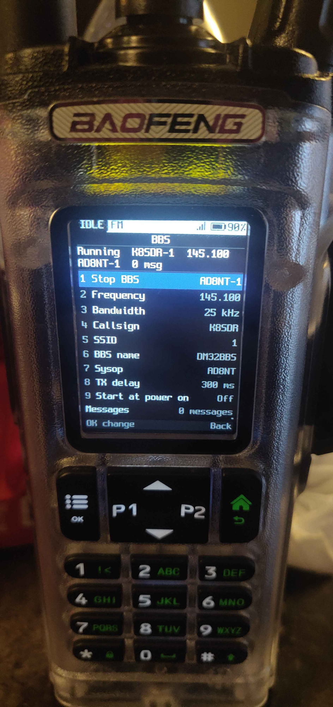

<!-- SPDX-License-Identifier: MIT -->

# DM32BBS

A **standalone packet-radio BBS that runs on the Baofeng DM-32UV handheld** — no PC, no hotspot, no internet. The radio
itself answers AX.25 connected-mode callers at 1200 baud, keeps a mailbox in its data flash, identifies in CW on a
schedule, and is controlled entirely from its own keypad.



*The photo shows the sysop's own callsigns; the build defaults to `N0CALL`.*

## What it does

- **On-radio BBS panel** is the whole user interface: Start/Stop, operating frequency, bandwidth, callsign/SSID, BBS
  name, sysop, TX delay, start-at-power-on, CW ID interval, and the mailbox. No PC needed to configure or use it.
- **Connected-mode AX.25 server** (`SABM`/`UA`, I/S frames, RR/REJ, T1/N2) at 1200 baud Bell 202, using the radio's
  APRS modem.
- **Mailbox in the data flash** (512-byte records, CRC-checked, crash-safe): list, read, send, kill, clear. A caller
  connects, types `S` and leaves a message; the sysop reads it on the radio.
- **Channel lock while running**: PTT, channel/zone/VFO changes, scan and quick settings are blocked, so the BBS keeps
  the channel. Stop releases it.
- **CW identification** every 5/10/15/30 minutes (or off), keyed in Morse with the configured callsign when the channel
  is idle.
- **Terminal client** for the other radio's KISS-over-TCP TNC (see `terminal/`).

## Using the radio

The radio boots straight to the BBS panel:

```
IDLE FM                         98%
                 BBS
Running  N0CALL  145.100
0 msg
1 Stop BBS            Running
2 Frequency           145.100
3 Bandwidth           25 kHz
4 Callsign            N0CALL
5 SSID                0
6 BBS name            DM32BBS
7 Sysop               N0CALL
8 TX delay            300 ms
9 Start at power on   Off
CW ID                 Off
Messages              0 messages
OK change  hold OK clear  Back
```

Select a row with OK. Frequency is typed on the digits and is band-checked; callsign/name/sysop use the keypad text
entry. **Start BBS** tunes the VFO to the configured frequency and locks the radio; **Stop BBS** releases it. While
running, you can still edit the frequency (it retunes), read the mailbox, and stop it.

CW ID: pick off, 5, 10, 15 or 30 minutes. The first ID follows shortly after Start; then one per interval while the
channel is idle.

## Client side

The BBS was tested from a second radio with a KISS-over-TCP TNC:

```
python3 terminal/terminal.py                # N0CALL-1 -> N0CALL on 145.100, 192.168.1.85:8001
```

Any AX.25 terminal works (`qttermtcp` was used too): connect `N0CALL-1` to `N0CALL`, then `H`, `L`, `R n`, `S`, `N`,
`Q`. Messages sent from the terminal appear on the radio's mailbox screen and persist across reboots.

## Build and flash

The firmware is a lean, vendored RadioFoundry build (FM + the HR_C7000 modem glue + APRS RF path + the BBS). The
default full RadioFoundry build is untouched and still builds.

```
tools/build-bbs.sh                          # -> firmware/build/bbs/rfoundry_dm32.bin
```

Flash with the runtime stub (radio on), or the bootloader update mode (PTT + SK1 at power-on):

```
cd firmware
python3 stub/stubtool.py /dev/ttyUSB0 --board dm32 --rfoundry-enter \
    --write-app build/bbs/rfoundry_dm32.bin
python3 stub/stubtool.py /dev/ttyUSB0 --attach --boot reset
```

The image has no DMR voice codec slot; FM and packet are unaffected (DMR voice is not needed for the BBS).

## Layout

| Path | What |
|---|---|
| `firmware/` | vendored RadioFoundry tree + `core/bbs/` (config, server, store, flash, radio glue) and the BBS UI |
| `firmware/docs/spec/bbs.md` | the BBS spec (protocol, UI, store, CW ID) |
| `terminal/` | KISS TCP AX.25 terminal client for the other radio |
| `tools/build-bbs.sh` | the lean DM32 BBS build |
| `docs/dm32-bbs.png` | the photo above |

## Limits

1200 baud Bell 202 only; one mailbox per radio; two callers at a time; no forwarding/NTS; the settings menu, Home and
the ham-radio screens are intentionally not offered in this BBS build. Radio voice settings (volume, power, backlight)
still work; display/language settings keep their stored values.
